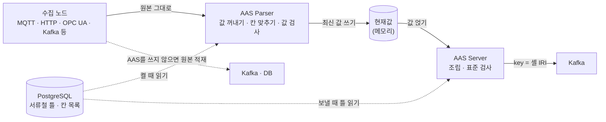

# AAS 자체 저장소 · 데이터 파이프라인 구조 정리

산업 데이터 수집 플랫폼(MQ 기반 데이터 파이프라인)에 **AAS(Asset Administration Shell)** 기능을 붙이면서 설계한 **데이터 흐름 구조와 테이블 구조**를 정리한 기록입니다.

- AAS는 설비 한 대의 제원 · 상태 · 문서를 국제 표준(IDTA AAS 3.1) 형식으로 담는 「설비 디지털 서류철」입니다.
- 이 저장소는 **구조 설명 문서만** 담습니다. 실제 소스 코드, 접속 정보, 운영 환경 정보는 포함하지 않습니다.

## 한눈에 보기

- **서류철의 모양(틀)** 은 PostgreSQL에, **칸에 들어갈 최신 값** 은 서버 메모리에 둡니다.
- 보낼 때 둘을 합쳐 표준 AAS JSON을 만들고, 3단계 검사를 거쳐 Kafka로 내보냅니다.
- 메시지 한 건마다 DB를 부르지 않습니다. DB는 켤 때, 주기 점검 때, 조립할 때만 읽습니다.

## 문서

| 문서 | 내용 |
|---|---|
| [02. 테이블 구조](docs/02-테이블-구조.md) | 테이블 16개의 역할, 논리 관계도, 조립 규칙, 파일 저장 방식, 단계별 읽기 · 쓰기 · 삭제 |
| [03. 설계 결정](docs/03-설계-결정.md) | 외부 AAS 서버 대신 자체 저장소를 둔 이유, 주요 구조 결정과 감수한 것 |

## 핵심 설계 원칙

1. **틀은 DB, 값은 메모리** — 수집 경로에서 설정 DB 쓰기를 없앴습니다.
2. **원문은 무손실 보관, 칸만 펼침** — 서브모델 원문은 JSON(jsonb) 그대로 두고, 값이 들어가는 끝 항목만 칸 목록으로 펼칩니다.
3. **이름은 마스터 표에만** — 하위 표는 코드 · 키만 들고, 이름은 조회 시점에 마스터에서 가져옵니다.
4. **매핑은 화면 설정으로** — 설비를 붙일 때 코드를 고치지 않고, 노드 설정에서 규칙을 만듭니다.
5. **표준 검사를 거친 것만 내보냄** — 값 형식 · JSON 스키마 · 표준 규칙 세 번 검사합니다.

## 기준

- 2026-10-15 기준 구조입니다.
- 사용 기술: Java 17 · Spring Boot · Apache Camel · PostgreSQL 16(jsonb) · Kafka · Eclipse AAS4J(직렬화 · 스키마) · aas-core3.1(Python 표준 규칙 검사) · React(설정 화면)
