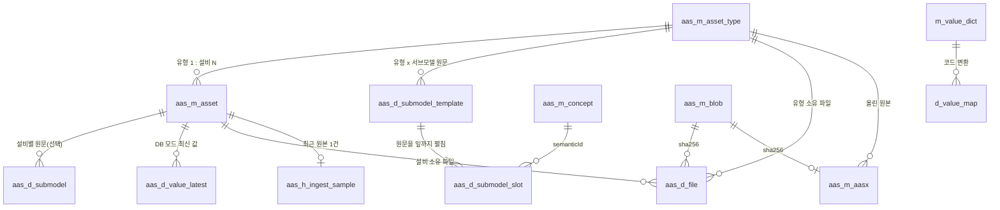

# 02. 테이블 구조

AAS를 PostgreSQL에 담는 테이블 16개의 역할과 관계입니다.

## 1. 이름 규칙

테이블 이름은 `aas_` 뒤에 성격을 붙입니다.

| 접두 | 뜻 | 예 |
|---|---|---|
| `m_` | 마스터 — 기준 정보 | `aas_m_asset` |
| `d_` | 디테일 — 마스터에 딸린 상세 | `aas_d_submodel_slot` |
| `h_` | 이력 · 기록 | `aas_h_ingest_sample` |

## 2. 두 묶음: AAS 직접 10개 · 보조 6개

| 묶음 | 테이블 | 하는 일 |
|---|---|---|
| 구조 | `aas_m_asset_type` | 자산 유형 = AAS 템플릿. 같은 종류 설비가 함께 쓰는 셸 골격과 셸 IRI 규칙 |
| 구조 | `aas_m_asset` | 설비 1대 = 셸 1개. 셸 IRI(전 세계 고유 ID)와 서버 안 짧은 이름표(셸 코드). 설비별로 다른 부분만 덮어쓰기 |
| 구조 | `aas_d_submodel_template` | 유형이 가진 서브모델 원문을 jsonb로 빠짐없이 보관 |
| 구조 | `aas_d_submodel` | 그 설비만 고쳐 저장한 서브모델 원문. 없으면 공통 원문을 씀 |
| 구조 | `aas_d_submodel_slot` | 원문을 값이 들어가는 끝 항목(잎)까지 펼친 **칸 목록**. 자료형 · 단위 · semanticId. 값을 넣을 칸을 찾는 기준 |
| 구조 | `aas_m_concept` | 개념 설명 사전. 표준 코드(semanticId)마다 이름 · 단위 · 정의(언어별) |
| 파일 | `aas_m_blob` | 파일 바이트. 내용 지문(sha256)당 한 벌만 저장 |
| 파일 | `aas_d_file` | 어느 요소가 어느 바이트를 쓰는지(유형 소유 / 설비 소유) |
| 파일 | `aas_m_aasx` | 올린 AASX 원본 파일 정보. 바이트는 blob에 |
| 값 | `aas_d_value_latest` | 칸 최신 값. **DB 저장 모드일 때만** 사용(기본은 메모리). 이력은 담지 않음 |
| 보조 · 수집 진단 | `aas_h_ingest_sample` | 설비별 최근 원본 메시지 1건 |
| 보조 · 수집 진단 | `aas_h_unknown_key` | 칸에 붙지 않은 키 |
| 보조 · 수집 진단 | `aas_h_unknown_asset` | 등록되지 않은 설비 대기열 |
| 보조 · 값 사전 | `m_value_dict` · `d_value_map` | 들어온 코드 값을 바꿔 적는 사전(예: `running` → `Driving`) |
| 보조 · 운영 | `aas_h_seed_ledger` | 기본 샘플 자산을 한 번만 넣게 하는 장부 |

- 수집 진단 표는 외부 시스템이 화면 흐름을 거치지 않고 값을 직접 보내는 수집 API가 씁니다. 화면에서 만든 데이터 흐름은 이 표에 쓰지 않습니다.
- 매핑 규칙은 표가 아니라 화면 흐름의 노드 설정에 저장합니다.

## 3. AAS 표준 개념과 담는 표

| AAS 개념 (IDTA 3.1) | 담는 곳 | 담는 방식 |
|---|---|---|
| AAS 템플릿 (설비 종류) | `aas_m_asset_type` | 셸 골격 JSON과 셸 IRI 규칙 |
| Asset Administration Shell | `aas_m_asset` | 설비 1대 = 셸 1개 |
| Submodel (공통) | `aas_d_submodel_template` | 원문 jsonb 무손실 보관 |
| Submodel (설비별) | `aas_d_submodel` | 설비만 고친 원문(선택) |
| SubmodelElement (잎) | `aas_d_submodel_slot` | 잎까지 펼친 칸 목록 |
| 요소의 현재값 | 메모리 · `aas_d_value_latest` | 기본 메모리, DB 모드면 경로당 1행 |
| ConceptDescription | `aas_m_concept` | semanticId별 사전 |
| File · Blob · 썸네일 | `aas_m_blob` + `aas_d_file` | 바이트는 한 벌, 요소에는 경로만 |
| AASX 패키지 | `aas_m_aasx` (+ blob) | 원본 파일 정보 |

## 4. 논리 관계도

DB가 강제로 묶는 외래키(FK)는 두지 않았습니다. 관계는 값으로 이어지는 **논리 관계**이고, 지우는 순서는 DB 안의 저장 프로시저가 지킵니다.

### 두 개의 축: 유형 축과 설비 축
- **유형 축**(`asset_type`, `submodel_template`, `submodel_slot`)은 같은 종류 설비가 **함께** 씁니다. 여기를 고치면 그 유형의 설비 전부가 바뀝니다.
- **설비 축**(`asset`, `submodel`, 설비 소유 `file`)은 **그 설비만**의 것입니다.
- 화면에서 설비 한 대의 서브모델을 고치면 설비 축에만 저장합니다. 칸 목록은 유형 공용이고 매핑 규칙이 칸에 기대므로, 설비 하나를 고쳤다고 형제 설비의 매핑이 끊기지 않게 하려는 것입니다.

## 5. 조립 규칙

- **서브모델 원문**: 설비별 원문 → 없으면 유형 공통 원문 → 없으면 칸 목록으로 합성
- **셸 뼈대**: 유형의 기본 골격에 그 설비만 다른 부분을 덮어써서 만듦
- 그 위에 최신 값을 얹어 화면에 보여 주거나 Kafka로 보냅니다.

### 왜 원문을 통째로 두고 칸만 펼쳤나
- 처음 설계안은 요소를 전부 행으로 펴는 방식(표 30여 개)이었습니다.
- 실제 표준 서브모델은 중첩이 깊고(8단까지 확인) 요소 종류가 13가지라, 행으로 펴면 복원할 때 정보가 빠지기 쉽습니다.
- 그래서 원문은 jsonb로 **무손실** 보관하고, 값이 들어가는 잎만 칸 목록으로 펼쳤습니다. 표 수가 줄고, 원문을 그대로 돌려줄 수 있습니다.

## 6. 파일: 바이트는 한 벌, 요소는 경로만

- 같은 파일은 내용 지문(sha256)이 같으므로 `aas_m_blob`에 한 번만 저장합니다.
- 요소 값에는 `/aas-files/{sha256}/{이름}` 경로만 남깁니다.
- 썸네일, AASX 첨부처럼 요소와 파일을 잇는 기록은 `aas_d_file`에 둡니다.
- 설비를 지워도 바이트는 남깁니다. 다른 설비가 같은 파일을 가리킬 수 있기 때문입니다.

## 7. 이름은 마스터에만

- 설비 · 유형 · 칸의 이름은 마스터 표에만 두고, 디테일 · 이력 표는 코드 · 키만 듭니다.
- 이름은 조회 함수(`ufnc_get_*`)로 가져옵니다. 마스터에서 이름을 바꿔도 하위 표를 고칠 필요가 없습니다.
- 칸 이름 · 단위는 **칸에 따로 적은 값 → 개념 설명 사전 → 경로의 마지막 이름** 순서로 정합니다.
- 개념 설명은 언어별(ko · en 등)로 합쳐 저장합니다.

## 8. 단계별로 거치는 표

R 읽기 · W 쓰기 · D 삭제. 접두 `aas_`와 `m_ · d_ · h_`는 줄여 적었습니다.

| 단계 | 읽는 표 | 쓰는 표 | 지우는 표 |
|---|---|---|---|
| 등록 (AASX · 패키지 올리기) | R asset (셸 판정) | W asset_type · concept · submodel_template · submodel_slot · asset (AASX면 blob · file · aasx도) | — |
| 수집 · 매핑 (실행 중) | R asset · submodel_slot · 값 사전 | 메모리 최신 값. **DB 쓰기 없음** | — |
| 조립 · 검사 | R asset_type · asset · submodel · submodel_template · submodel_slot + 메모리 | — | — |
| 화면 조회 | R 조립 표 + file · blob(썸네일) | — | — |
| 설비 서브모델 편집 저장 | R asset | W submodel (파일이면 blob) | — |
| 설비 삭제 | — | W unknown_asset (연결만 끊기) | D value_latest · submodel · file(설비) · asset_alias · ingest_sample · asset |
| 유형(템플릿) 통째 삭제 | R 전체 | W unknown_asset (연결만 끊기) | D 설비 삭제 전부 + submodel_slot · submodel_template · file(유형) · unknown_key · asset_type |
| 서버 기동 (기본 자산 시드) | R seed_ledger | W seed_ledger, 장부에 없을 때만 asset_type · asset · submodel_slot · 값 사전 | — |

- 값 이력은 AAS 표에 없습니다. 이력은 Kafka 뒤에서 값을 최종 저장하는 하류 DB가 맡습니다.

## 9. 관리 작업과 저장 프로시저

화면에서 서류철을 저장 · 삭제하는 작업은 여러 표를 한 번에 고치므로 **화면별 저장 프로시저**로 처리합니다. 실시간 데이터 흐름은 프로시저를 쓰지 않고 읽기만 합니다.

| 화면 작업 | 처리 |
|---|---|
| 템플릿(유형) 올리기 · 저장 | 유형 한 벌 저장 프로시저 — 서브모델 원문, 칸 목록, 개념 설명, 파일을 신규 · 수정 통합으로 저장 |
| 설비 서브모델 한 장 저장 | 서브모델 한 장 저장 프로시저 — 설비 축에만, 칸 목록은 그대로 |
| 설비 삭제 | 설비 삭제 프로시저 — 아래 순서로 한 트랜잭션에서 삭제 |
| 유형 통째 삭제 | 설비마다 설비 삭제 → 유형 묶음 삭제 |
| 매핑 저장 | 프로시저 없음 — 노드 설정에 저장 |

### 설비 삭제 순서 (아래에서 위로)
1. 최신 값 (`aas_d_value_latest`)
2. 설비별 서브모델 (`aas_d_submodel`)
3. 설비 소유 파일 연결 (`aas_d_file`)
4. 별칭 (`aas_d_asset_alias`)
5. 수집 표본 (`aas_h_ingest_sample`)
6. 미등록 설비 이력 — 지우지 않고 연결만 끊음 (`aas_h_unknown_asset`)
7. 설비 (`aas_m_asset`)

- 유형과 템플릿은 다른 설비가 함께 쓰므로 남깁니다. 그 유형의 마지막 설비였다면 지우지 않고 알려 주기만 합니다(지울지는 사람이 정함).

### 프로시저 공통 규칙
| 규칙 | 이유 |
|---|---|
| 화면 하나에 프로시저 한 벌. 저장(`_c`)과 조회(`_r`)를 나눔 | PostgreSQL에서 FUNCTION은 반환형이 고정이고 PROCEDURE는 결과 집합을 돌려주지 못해 하나로 합칠 수 없음 |
| 입력은 jsonb 하나, 작업 구분은 `'C'`(저장: 신규 · 수정 통합) / `'D'`(삭제), 결과 코드 0 = 성공 | 여러 건을 한 번에 넘기기 위함. 임시 테이블은 커넥션 풀이 세션을 재사용할 때 충돌 |
| 트랜잭션 경계는 애플리케이션이 잡고, 결과 코드가 0이 아니면 애플리케이션이 예외를 던져 전체를 되돌림 | 프로시저 안에서 오류를 잡으면 「정상 종료」로 끝나 반쯤 저장된 채 커밋될 수 있음 |
| 행 단위 루프 대신 집합 연산 | 루프마다 생기는 세이브포인트가 쌓이면 동시성이 크게 떨어짐 |
| 생성자 · 수정자 · 수정일은 프로시저만 채움. 실제로 고친 경우에만 수정일을 올림 | 아무것도 안 고친 저장이 목록의 수정일을 바꾸지 않게 |

## 10. 스키마 변경 원칙

- 표 · 컬럼 변경은 버전 마이그레이션 파일로, 함수 · 프로시저는 반복 마이그레이션 파일로 관리합니다(배포 때 자동 적용).
- 모든 구문은 여러 번 실행해도 결과가 같게(멱등) 쓰고, 표가 있는지 확인한 뒤 실행합니다.
- 마이그레이션 오류로 서버 기동을 막지 않습니다. 이미 적용된 버전 파일은 고치지 않습니다.
- 노드 종류를 없앨 때는 노드 템플릿 · 연결 규칙 · 팔레트 행만 지우고, 사용자가 만든 흐름(노드 · 선)은 지우지 않습니다.
