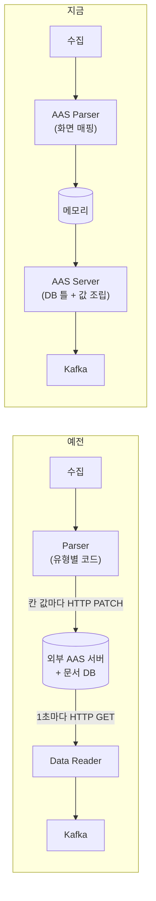

# 03. 설계 결정

구조를 지금 모양으로 정한 이유와 그 대가입니다.

## 1. 외부 AAS 서버 대신 자체 저장소

처음에는 오픈소스 AAS 서버(Eclipse BaSyx)가 서류철을 보관했습니다.

| 항목 | 예전 | 지금 | 좋아진 점 |
|---|---|---|---|
| 서류철 보관 | 외부 AAS 서버(여러 컨테이너 + 문서 DB, 개발판 버전) | 애플리케이션이 원래 쓰던 PostgreSQL | 따로 운영할 서버가 없어지고, 오프라인 설치 패키지에도 AAS가 들어감 |
| 값 쓰기 | 칸 값마다 HTTP PATCH | 메모리에 바로 씀 | 네트워크 왕복이 없고, 외부 서버 장애가 수집을 막지 않음 |
| 내보내기 | 1초마다 HTTP로 다시 읽어 보냄. 값이 그대로여도 같은 내용 반복 | 값이 들어온 만큼, 바뀐 만큼, 1초마다 중 선택 | 중복 메시지가 줄고 지연이 짧아짐 |
| 설비 추가 | 유형마다 매핑 코드를 짜서 다시 배포 | 화면에서 매핑 규칙 작성, 저장 전 검사, 재시작 없이 반영 | 개발 없이 현장에서 설비를 붙임 |
| 셸이 없을 때 | 외부 서버에 셸이 없으면 흐름이 시작 못 함 | 셸은 DB 행, 파일을 올리면 바로 생김 | 준비 순서가 단순하고 두 저장소가 어긋날 일이 없음 |
| 표준 검사 | 스키마 검사만 | 값 형식 · 스키마 · 표준 규칙 3단계 | 표준에 어긋난 데이터가 덜 나감 |
| Kafka key | 없음 | 셸 IRI | 설비 구분과 설비별 순서 보장 |
| 노드 | 5칸(Parser 2종 + Data Reader) | 4칸(Parser 1종) | 붙일 수 있는 수집 노드가 4종에서 10종으로 |

검토한 다른 안:
- **외부 서버 유지 + 확장**: 이름 · 값 이력 문제는 어차피 우리 표가 필요했고, 남는 차이는 「구조를 누가 보관하나」뿐인데 그 대가가 서버 스택 하나였습니다.
- **다른 오픈소스 AAS 서버로 교체**: 외부 서버라는 구조적 한계가 같습니다. 대신 **모델 · 직렬화 라이브러리(AAS4J)** 는 빌려 씁니다.

## 2. 현재값은 메모리에

- 매 메시지마다 설정 DB를 갱신하면, 설비 여러 대 × 초당 수십 건에서 초당 수천 건의 갱신이 생깁니다.
- 「틀은 DB, 값은 메모리, 받은 값은 바로 Kafka로」라는 단순한 구조로 정했습니다. 값 이력은 Kafka 뒤의 하류 DB가 맡습니다.
- 설정 하나로 DB에 쓰는 방식으로 되돌릴 수 있게 남겨 두었습니다.

## 3. 프로토콜별 Parser를 공통 Parser 하나로

- MQTT용 · OPC UA용으로 나뉜 Parser는 이름과 실제 쓰임이 맞지 않았고, 새 수집 노드를 붙일 때마다 종류를 늘려야 했습니다.
- 매핑 엔진은 원래 하나였고 차이는 입력 모양뿐이라, 입력 변환은 앞 단계(OPC UA 태그 → JSON)에서 하고 Parser는 하나로 합쳤습니다.
- 노드 종류 문자열은 실행기 선택 · 연결 규칙 · 저장된 흐름에 박혀 있어 이름만 바꿀 수 없으므로, 새 종류를 만들고 옛 종류는 지웠습니다. 사용자가 만든 흐름의 노드 · 선은 지우지 않고, 켤 때 안내합니다.

## 4. 조립 · 검사 · 전송을 AAS Server 한 곳에

- 예전에는 AAS Server 노드가 주소만 들고 실제 일은 뒤쪽 두 단계에 흩어져 있었습니다.
- 조립 · 검사 · 전송을 AAS Server → Kafka 단계 하나로 모으고, 중간 노드(Data Reader)를 없앴습니다.
- Parser에서 Kafka로 바로 가는 길은 두지 않았습니다. **AAS 적재는 반드시 검사를 거친다**는 원칙 때문입니다.

## 5. 표준 규칙 검사는 별도 Python 서비스

- 표준 규칙(이름 중복, 목록 규칙 등)의 공식 검증 도구가 Python 라이브러리(aas-core3.1)입니다.
- 본체(Java)에 같은 규칙을 다시 짜지 않고, 작은 HTTP 서비스로 분리해 설치 패키지에 함께 넣었습니다.
- 서비스가 없으면 ③ 검사만 건너뛰고, `reject` 수준이면 응답할 때까지 보내지 않습니다.

## 6. 감수한 것

| 대가 | 대응 |
|---|---|
| 서버를 재시작하면 최신 값이 비어 있음 | 다음 메시지가 들어오는 순간 채워짐. 「빈칸으로 시작」을 의도된 동작으로 정함 |
| 서버를 여러 대로 늘리면 최신 값을 나눠 갖지 못함 | 현재 단일 서버 운영. 늘릴 때 공유 저장소로 옮김 |
| AAS 표준을 지키는 책임이 우리에게 옴 | 공식 라이브러리 스키마와 공식 검증 도구로 보낼 때마다 검사 |
| 표준 AAS REST API 전체 제공은 일부만 | 후속 과제 |
| 같은 원천에 여러 하류를 걸 때 일부 원천은 메시지를 나눠 가짐 | 원천별 읽기 큐로 단계적으로 해결 중 |
